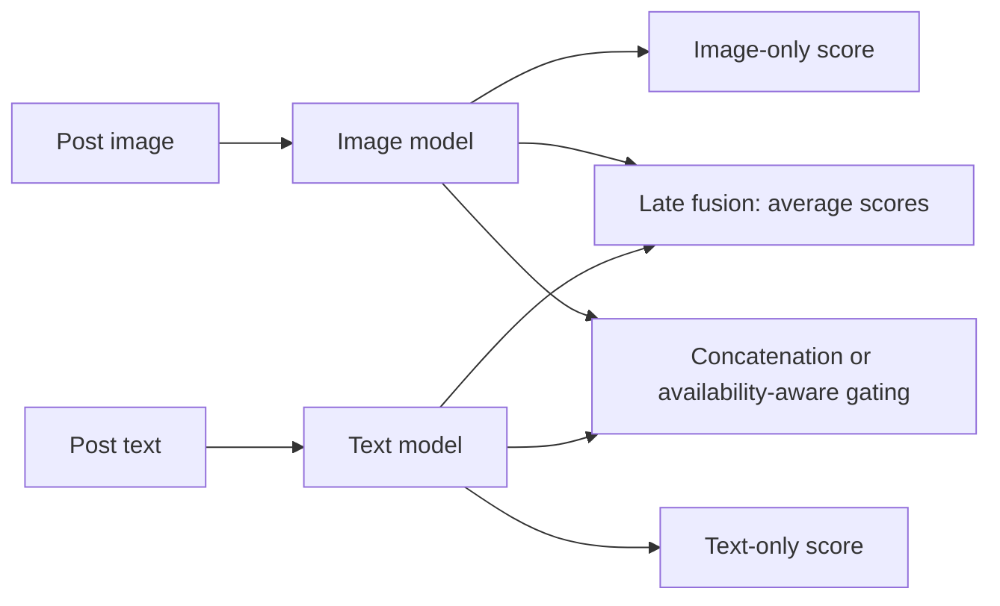
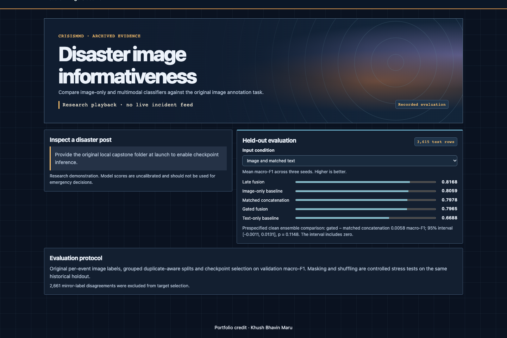
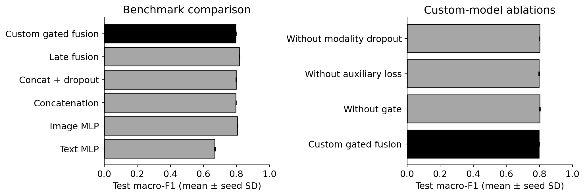

# Image informativeness in disaster posts

Khush Bhavin Maru · COMP6001 Computer Vision and Multimodal Machine Learning

**Project timeline:** **2026 master’s capstone** at Adelaide University.

This project classifies whether an image in a disaster-related post is informative. It compares text-only and image-only baselines, concatenation, late fusion, and a custom availability-aware gated model. The gated model uses feature-wise fusion, explicit missing-input masks and auxiliary unimodal losses.


## How the models combine image and text



The project compares standalone modalities, score averaging, and feature fusion. The figure under [Results](#results) shows the measured comparison alongside missing-input ablations.

## Quick demo

Compare the clean, missing-text and shuffled-text results in the archived CrisisMMD dashboard.

[Watch the 23-second captioned walkthrough](https://raw.githubusercontent.com/Khushx11/disaster-image-classifier/main/docs/demo/walkthrough.mp4)

[](https://raw.githubusercontent.com/Khushx11/disaster-image-classifier/main/docs/demo/walkthrough.mp4)

## My contribution

For my COMP6001 capstone, I evaluated image-only, text-only and multimodal fusion systems for CrisisMMD image informativeness. The coursework covers the label audit, duplicate-aware split, modality ablations and grouped inference. The public edition adds the evidence dashboard and a separate leave-one-event-out evaluation.

## Unseen-event evaluation

I evaluated fixed linear image and text classifiers, an equal-weight late-fusion model, and a training-majority baseline across seven folds. Each fold held out one entire disaster event and removed training rows sharing a duplicate group with that event. The text vocabulary and image standardisation were fitted within each fold. Image features came from a frozen ImageNet ResNet18 cache whose manifest and row order were verified before use.

- **Late fusion** · 0.7651 mean event macro-F1
- **Image only** · 0.7512
- **Text only** · 0.6137
- **Training-majority baseline** · 0.3392

Late fusion scored from 0.6958 to 0.7893 across events with 597 to 4,556 test rows each. This follow-up measures fixed linear baselines under an event-held-out split. The original gated architecture and the original late-fusion checkpoints were outside this experiment.

[Per-event scores, label support and confusion matrices](results/unseen_events.json) · [Experiment script](scripts/evaluate_unseen_events.py)

Generate a feature archive using the original data and feature stages in [Review and reproduce](#review-and-reproduce). Use the archive's own manifest as the image manifest. The script checks alignment before fitting and records both manifest hashes. The recorded run used the submission's cleaned text and the independently rebuilt image cache.

```sh
python scripts/evaluate_unseen_events.py data/manifest.csv \
  --image-features work/features/features.npz \
  --image-manifest data/manifest.csv \
  --output results/unseen_events.json
```

## Interview dashboard

Run `python portfolio_demo.py` and open http://127.0.0.1:8003. Explore the recorded results for matched, missing and shuffled inputs. The dashboard uses the Python standard library in this mode.

For live inference, install the requirements and point the dashboard at the original local capstone folder:

```sh
python portfolio_demo.py --evidence "/path/to/COMP6001_Capstone 2"
```

The dashboard verifies the [original evidence checksums](results/demo_inputs.sha256) before loading the local models. Upload a JPEG, PNG or WebP and optionally supply a caption. It reports the gated ensemble, late fusion and the image-only baseline on the same image. Captions with no vocabulary matches use the missing-text path. The demo serves only on localhost and keeps uploads in memory. Scores describe image informativeness and are uncalibrated.

## Results

Late fusion averaged the predictions of the trained image and text models. It achieved the best mean clean-test macro-F1 across seeds 42, 43 and 44.

- **Late fusion** · 0.8168
- **Image-only model** · 0.8059
- **Concatenation with modality dropout** · 0.7978
- **Gated fusion** · 0.7965

The prespecified test compared the three-seed gated ensemble with the matched concatenation ensemble. The gated ensemble's macro-F1 was 0.0058 higher, with a 95% group-bootstrap interval of −0.0011 to 0.0131 and a two-sided paired randomisation p-value of 0.1148. The interval includes zero. [Seed-level metrics](results/metrics.csv) · [Ensemble metrics](results/ensemble_metrics.csv) · [Grouped test](results/statistics.json)




## Design and evaluation

- **Target.** The original CrisisMMD image-informativeness labels define the task. The audit found 2,661 disagreements with the mirror's JSON labels. [Dataset audit](results/data_audit.json)
- **Features.** Training-only TF-IDF and truncated SVD encode text. Frozen ImageNet ResNet18 encodes images. The fusion architectures and training loops are implemented in PyTorch. [Architecture](results/figures/architecture.png)
- **Splits.** A fixed grouped split prevents repeated tweet IDs, identical decoded images and sufficiently long identical cleaned text from crossing partitions. Validation macro-F1 selects checkpoints. The test set contains 3,615 rows. [Protocol](protocol.json)
- **Stress tests.** Masking text or image inputs and shuffling text–image pairings measure sensitivity under controlled perturbations. Event coverage, annotation disagreement and exact-match grouping limit generalisation. [Stress tests](results/figures/robustness.png) · [Learning curves](results/figures/learning_curves.png)

## Automated evidence verification

The lightweight CI workflow validates the committed numerical evidence without downloading private tweet content or rerunning neural-network training. It checks class/split counts, measured seed and modality-condition coverage, aggregate scores, the prespecified hypothesis test and consistency with the recorded full-rerun evidence.

```sh
python scripts/verify_evidence.py
```

The resulting [GitHub Actions evidence report](.github/workflows/evidence.yml) makes repository integrity easier to inspect during code review. **Passing this check is not an independent reproduction of model accuracy.** The original end-to-end reproduction procedure is described below and its record is retained in [full reproduction validation](results/full_reproduction_validation.json).

## Review and reproduce

Start from the repository root with Python 3.13.

```sh
python -m venv .venv
source .venv/bin/activate
python -m pip install -r requirements.txt
python -m src verify
```

Open [Capstone.ipynb](Capstone.ipynb) to review aggregate results and run architecture and cache checks without downloading CrisisMMD. Full reproduction downloads the pinned data and ImageNet weights, then rebuilds features, trains 24 models and evaluates them in a new directory under `runs/`. Allow several GB for downloads and generated files. A GPU helps with image feature extraction.

```sh
python -m src reproduce
```

Use `--reuse-data` if `data/raw/` already contains the downloaded dataset. After training, run inference from the new experiment directory.

```sh
python -m src.predict --image /path/to/image.jpg --text "Flood water covers the road"
```

The original full rerun reused the original raw downloads and rebuilt features and models. Its clean three-seed mean macro-F1 differed by up to 0.0041 across models, and late fusion ranked first again. [Full rerun record](results/full_reproduction_validation.json)

## Credits and rights

Coursework by Khush Bhavin Maru. Codex prepared the portfolio packaging, cleared saved notebook outputs and adapted the review cells to use aggregate evidence. Raw images, posts, per-row manifests and predictions, checkpoint weights, report and presentation files remain in the original project.

CrisisMMD by Firoj Alam, Ferda Ofli and Muhammad Imran, ICWSM 2018. QCRI lists the dataset under CC BY-NC-SA 4.0. The dataset licence applies to dataset material. [CrisisMMD project](https://crisisnlp.qcri.org/crisismmd) · [Pinned QCRI mirror](https://huggingface.co/datasets/QCRI/CrisisMMD/tree/10a5626ba112ab9c50369c473a2062bcf205d708) · [Dataset licence](data/LICENSE_CrisisMMD.txt)

The visual feature extractor uses ResNet18 by Kaiming He, Xiangyu Zhang, Shaoqing Ren and Jian Sun. The fusion design builds on gated multimodal units and modality dropout. [ResNet](https://arxiv.org/abs/1512.03385) · [Gated Multimodal Units](https://arxiv.org/abs/1702.01992) · [Torchvision weights and transforms](https://docs.pytorch.org/vision/stable/models/generated/torchvision.models.resnet18.html)

The dashboard’s local model replay uses the original evidence on your own machine. [Adelaide University Academic Integrity Policy](https://adelaide.edu.au/about/policies/academic-integrity-policy/)
